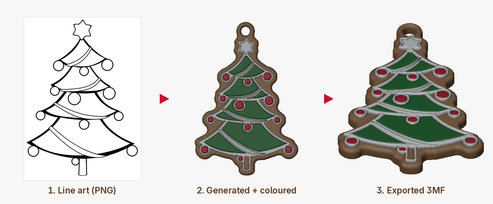

# Gingerbread Ornament: a Blender add-on

Turn any line drawing or colouring page into a multi-colour, 3D-printable gingerbread ornament.

You give it a black-and-white drawing. It builds:

- a **cookie** with a rounded, "baked" top edge and a flat bottom;
- **piped icing lines**, each one a rounded bead like real royal icing;
- **flood icing** in every enclosed area, in any colour you pick (or left as bare cookie);
- a **hanging hole** in a tab at the top.

Then it exports a **3MF that opens in Bambu Studio** with every part already set to the right filament and colour. Slice it and print.

---

## What you need

- **Blender 5.1 or newer** (free from blender.org). Tested on Blender 5.1.1.
- **Bambu Studio** to slice and print the 3MF.
- **A Bambu Lab printer.** The built-in print settings are for a **P1S with a 0.4 mm nozzle**. Other Bambu printers work too: open the 3MF and switch the printer in Bambu Studio, or use *Printer Settings From* (see below).
- **An AMS for multi-colour printing.** One AMS holds 4 colours, which is plenty for most ornaments (cookie, white icing, plus two colours). With no AMS you can still print a single-colour ornament, or swap filament by hand.

## Install

1. Download `gingerbread_ornament-0.5.0.zip`. **Don't unzip it.**
2. In Blender: **Edit → Preferences → Get Extensions**.
3. Click the small **⌄** menu at the top right and choose **Install from Disk…**
4. Pick the zip. The add-on installs and switches on.
5. In the 3D Viewport, press **N** to open the sidebar and click the **Gingerbread** tab.

To update later, remove the old version in Get Extensions first, then install the new zip.

## Quick start (5 minutes)

1. **Pick your drawing.** In box **1. Images**, set **Line Art** to a black-on-white PNG or JPG.
   *Optional:* set **Coloured (optional)** to a copy of the same drawing that you have coloured in. Each enclosed area then takes its colour from that copy, and white areas stay bare cookie.
2. **Generate.** Leave box **2. Shape** at its defaults for now (80 mm ornament) and click **Generate Ornament**. After a few seconds the cookie appears in the viewport.
3. **Colour it.** In box **3. Colours (filament slots)**:
   - Click **Add Filament**. You go straight into **colouring mode**: an orange frame and a banner show it's on.
   - Click any region or icing line in the viewport to paint it with that filament.
   - **Shift-click** = bare cookie. **Alt-click** = pick up a region's colour. **1–9** = switch filament.
   - Change a filament's colour swatch and every part using it updates.
   - Leave colouring mode with **Esc**, a **right-click**, or the red **Stop Colouring** button.
4. **Export.** In box **4. Export**, give it a **Title**, click **Export 3MF…** and choose where to save it.
5. **Print.** Open the 3MF in Bambu Studio. The filaments and colours are already set up: load matching filament in your AMS, slice, and print.

A sample, `sample_christmas_tree.3mf`, comes with the Gumroad download so you can see the result in Bambu Studio straight away. It prints in about 52 minutes on a P1S and uses about 14 g of PLA in 4 colours.

## The controls

### 1. Images
- **One Image** / **Several Images**: one ornament, or a batch.
- **Line Art**: the black line drawing.
- **Coloured (optional)**: the same drawing coloured in, to colour regions automatically.
- In **Several Images** mode:
  - **Add Images** picks several drawings at once.
  - Each row has its own title, an optional coloured image, and a tick to include it. Use the arrows to reorder and **Remove Image** to drop one.
  - **Generate Ornament** makes one ornament per ticked image, side by side in one scene.
  - All the ornaments share **one set of filaments**, so you can paint any of them with the same slots. **Max Filaments** counts the whole set.

### 2. Shape
- **Size (mm)**: longest side of the finished ornament, hanging tab included (default 80 mm).
- **Cookie Thickness**, **Cookie Edge Round**: how thick the cookie is and how rounded its top edge is.
- **Piping Height**, **Flood Height**: how far the icing lines and coloured areas stand above the cookie.
- **Line Thicken (mm)**: makes thin lines thicker so they print well. Raise it if fine lines disappear.
- **Line Smoothing (mm)**: smooths out pixel "stair-steps" in the lines. 0 = follow the pixels exactly.
- **Hanging Hole** and **Ø**: switch the hole on/off and set its diameter.
- **Max Filaments**: merges the most similar colours until the ornament fits this many filaments (4 = one AMS, 8 = two). 0 = no limit (you're warned above 4).
- **Icing Lines**: how lines are split into colourable parts: **Each Stroke** (default), **Connected Pieces**, or **One Part**.
- **Icing Look**:
  - **Puffed**: each coloured area is a raised, domed flood, with the piped lines standing above it.
  - **Painted**: coloured areas sit flush with their outlines, one flat "painted" surface.
  - **Seamless**: the whole iced area is one flat surface; only the colour changes, like an inlaid glaze.
- **Cookie**, **Icing**: default cookie and icing colours.
- **Advanced**: detail resolution, **Line Threshold**, **Min Region**, cookie margin and outline smoothing, piping/flood edge shapes, hole wall, **Colour Merge**.

Changed a Shape setting? Click **Generate Ornament** again.

### 3. Colours (filament slots)
- Each row is one filament: its **◉** button (paint with it), colour swatch, name, **paint selected parts** and **select parts** buttons.
- **Add Filament**, **Bare Cookie**.
- **Click Also Sets**: lets a click in colouring mode also set the style (**Colour Only**, **Puffed**, **Painted**).
- **Click to Colour Regions**: enter colouring mode.
- **Ctrl-click** in colouring mode switches a region between Puffed and Painted.
- With a part selected you can set its **Style** (regions: Puffed / Painted; lines: Auto / Raised / Flush).
- **Icing Look** + **Apply Look to All** restyles the whole ornament at once.
- A warning appears if you use more filaments than **Max Filaments** (or more than 4 if it's 0).

### 4. Export
- **Title**: the name Bambu Studio shows.
- **Export 3MF…**: you choose the file name when you click it.
- In **Several Images** mode there are two exports. Every file gets the same filament list and slot numbers, so one AMS setup prints them all.
  - **Export Plate 3MF…** puts every ornament on one plate in one file, titled by **Plate Title**.
  - **Export Each 3MF…** writes one file per ornament into a folder you choose.
- **Printer settings (optional) → Copy from**: leave it empty to use the built-in Bambu Lab P1S settings. Or pick any 3MF that Bambu Studio saved for *your* printer, and its printer and filament presets are copied into the export. The line under it tells you which settings will be used.

## Tips for good line art

- **Clean black lines on white** work best. Colouring pages are ideal.
- **Closed shapes** become colourable regions. A gap in a line lets two areas merge into one; close it in any paint program.
- **Avoid grey shading, dotted lines and scattered dots** (snow, stars). Shading becomes icing, dotted lines don't divide areas, and scattered marks bulge the cookie outline. Erase them first, or raise **Line Threshold** (Advanced) to ignore light grey.
- **Big solid black areas** (boots, belts) become big white icing blobs. Click them in colouring mode and give them a colour.
- **Known limit: very fine lines.** Very fine lines in a drawing (under about 0.4 mm at print size, like fur strokes) can come out too thin to print; use bolder outlines or a larger size. Very close detail can also merge together at 80 mm.
- **Resolution**: 600–1500 px on the long side is plenty. **Line Smoothing** handles low-res images.
- Only use drawings you have the right to use. The sample ornaments use public-domain (CC0) art from openclipart.org.

## Troubleshooting

- **I can't find the panel.** Press **N** in the 3D Viewport and click the **Gingerbread** tab. Check the add-on is switched on under Preferences → Get Extensions.
- **"Install from Disk" fails.** Make sure you picked the .zip itself, not an unzipped folder, and that you're on Blender 5.1 or newer.
- **Regions I expected aren't there.** The line around them has a gap, or the area is smaller than **Min Region** (Advanced). Close the gap or lower Min Region, then Generate again.
- **Thin lines vanish or break.** Raise **Line Thicken**.
- **The outline is lumpy or has bumps.** Erase stray marks outside the drawing, or raise **Outline Smoothing** (Advanced).
- **Too many colours / "filaments in use" warning.** Set **Max Filaments** to 4 and Generate again, or repaint parts with fewer filaments.
- **Bambu Studio asks about presets or shows the wrong printer.** Choose your printer in Bambu Studio after opening, or set **Copy from** to a 3MF Bambu Studio saved for your printer and export again.
- **"File not found" / "Not a .3mf file" under Copy from.** That field is optional and is *not* the output file. Clear it to use the built-in P1S settings.
- **Colouring mode won't stop.** Press **Esc**, right-click in the viewport, or click **Stop Colouring**.

## Licence

The add-on is free software under the **GNU General Public License v3.0 or later** (GPL-3.0-or-later). The full text is in `LICENSE`, inside the zip.

That means you may use it for anything (including selling the ornaments you print), study and change the code, and share copies, modified or not, as long as you pass them on under the same licence.

A ready-to-install package, the sample files and the guide are also on Gumroad (pay what you want); paying there supports the project.

The built-in Bambu Lab printer settings come from Bambu Studio's profiles (AGPL-3.0). See `CREDITS.md`.
